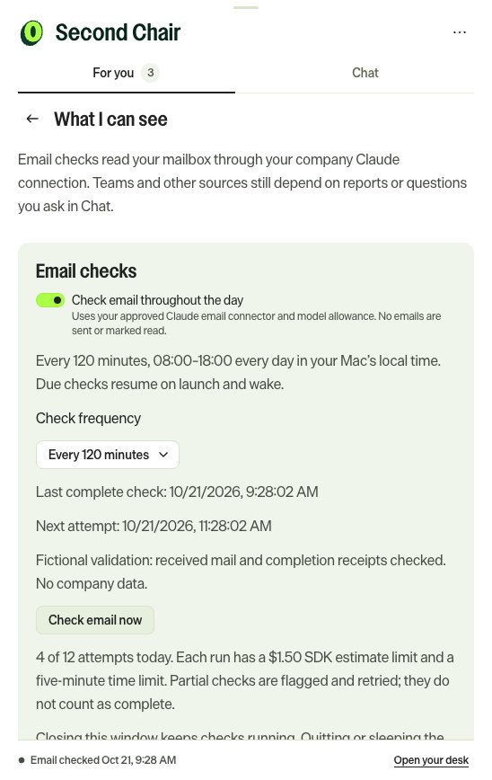

# Email monitoring — 0.4.0

Enable **More options → Source health → Check email throughout the day** once. For new installations
and upgrades this is off until enabled; the setting persists. Use the company's approved Claude
login and its connected read-only email tools. No separate API key, Microsoft bot, or Okta
integration is installed. Signing into Outlook alone does not authorize this connection.

## Cadence and recovery

- Default hourly, from 08:00 until 18:00 **every day**, in the Mac's local timezone. Choose 30/60/120
  minutes in Source health. The next due time is persisted, not reset by restarting.
- On launch and native wake the app checks whether a scan is due. It performs one catch-up run,
  not a separate run for every missed interval. Outside checking hours it schedules the next 08:00.
- **Check email now** can run outside checking hours, but honors pause, enabled state, and daily cap.
- Failures retry after 5, 15, then 60 minutes within checking hours. No overlapping scans or chat
  model requests. A running scan temporarily makes new chat submissions unavailable.
- First scan searches the preceding 30 days. Later scans start one day before the last completely
  successful window, catching delayed mail and updates. Partial runs retain findings but do not
  advance that checkpoint. A persisted continuation carries the incomplete coverage and exact window
  into the next attempt, which finishes those gaps before starting a newer window. Busy mailboxes may exceed a run's time/turn budget; the app must report
  partial coverage, not promise all mail was processed.
- Closing the window leaves the app running. Quit, sleep, shutdown, and lost connectivity prevent
  checks. **Start at login** in the O menu controls reboot/login startup; the app registers it on
  first installation, respecting a later opt-out or management policy. This is local execution,
  not a cloud service; it cannot notify while its process is stopped. Reopen it to recover after a crash.

## What counts as an obligation

The scanner searches received mail broadly and targeted training, approval, HR/payroll, security,
compliance, access and deadline messages. It reads candidate bodies and checks replies/receipts.
Automated messages and external sender labels do not disqualify company obligations. Optional
promotions/newsletters are excluded. Read status never implies completion.

One course assignment/cycle, approval request, or deliverable has one stable identity. Reminder
messages append events to that thread. The scanner receives existing obligation context and can
update an older report's finding without replacing its historical coverage. Exact message IDs
prevent repeated reads from creating new events. Semantic matching relies on Claude's evidence
interpretation and may need correction for ambiguous assignments; it is not a guaranteed complete
mail archive. Different courses and new recurring assignment cycles remain separate.

Routine reminders preserve read/snooze/local Done. A verified new request or explicit escalation
can reopen the thread. Completion needs evidence, or your local Done choice. A promise to do the
course is not completion. Approaching deadlines re-alert once within three days, once within a day,
and once overdue, while the obligation remains actionable. These local deadline checks do not
make model calls and are based on the reported date, not a live portal completion check.

## Failure visibility

Source health displays last attempt, last **complete** scan, next attempt, scope, error, and today's
attempt count. Failed authentication, denied tools, malformed output, partial coverage, timeout,
and daily-limit exhaustion produce a persistent **Email checks need attention** finding and footer.
There is one notification per incident, subject to your notification/quiet-hour preferences. A
successful complete scan clears the incident. No zero-result inference can silently clear an open
obligation. No connector availability ping is presented as an email content check.

## Usage and boundaries

At most **12 attempts per local day**, including manual attempts and interrupted runs; changing
cadence or restarting does not reset this. Each scan has a five-minute model timeout, 24-turn limit,
and $1.50 SDK-estimated budget. The combined estimate limits are up to $18/day, not an expected
bill or a hard billing guarantee (SDK limits are checked between operations). Company subscription
allowance/rate limits still apply. Source health explains the cap; Usage and cadence combines
recorded scan and chat tokens/cost estimates. Missing accounting on an interrupted run is unknown.

Only tools identified as read-only are enabled from Microsoft 365, Outlook, or the Optimizely email
connector; personal Gmail and other unrelated connectors are excluded. Tools are limited to email and Microsoft 365 resource/identity
reads needed for email retrieval. No sending, read-marking, drafts, shell tools, or browser login
is enabled. Connector data and existing obligation context go to your configured Claude service;
local storage does not mean local model execution. Teams monitoring is still report-driven or
on-demand chat. The app does not perform courses, grant approvals, or verify completion by logging
into a learning portal.

The context currently supports up to 249 email-related obligations (excluding completed findings
older than 90 days); at 250 it raises an explicit limit warning.
Nothing is silently discarded. Large-history retention and incremental connector-native ingestion
are follow-up work.

## Current interface

This screenshot is an isolated validation fixture. It contains no company email or real scan result.
